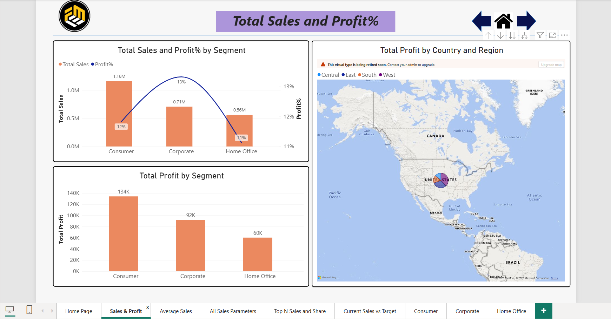
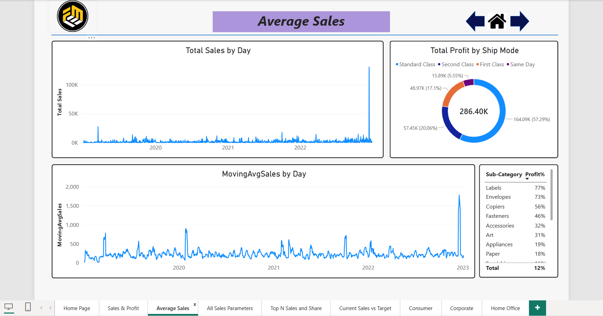
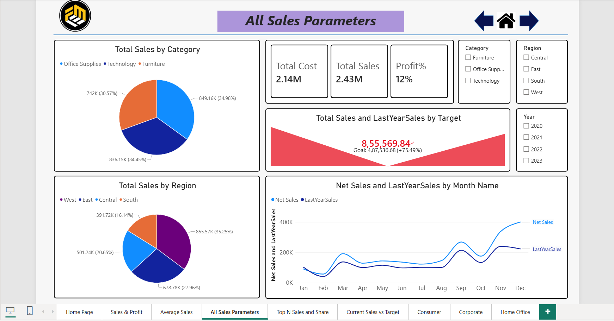
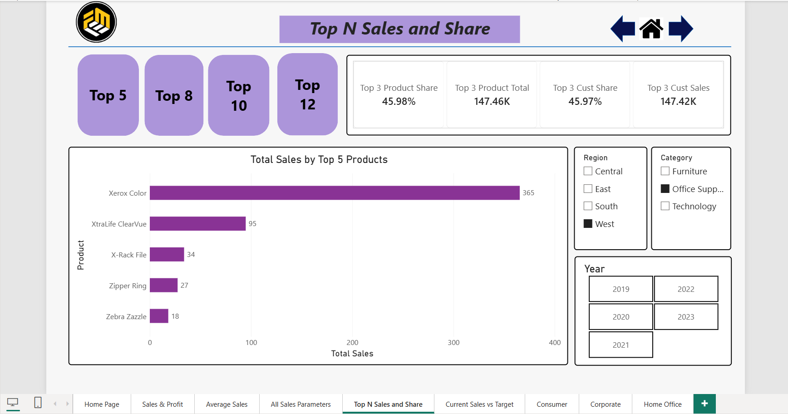
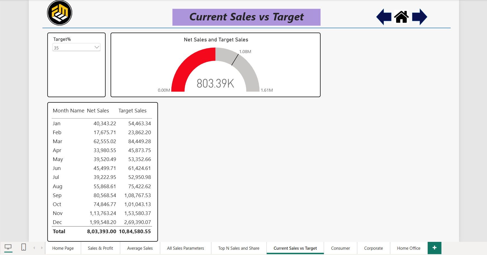
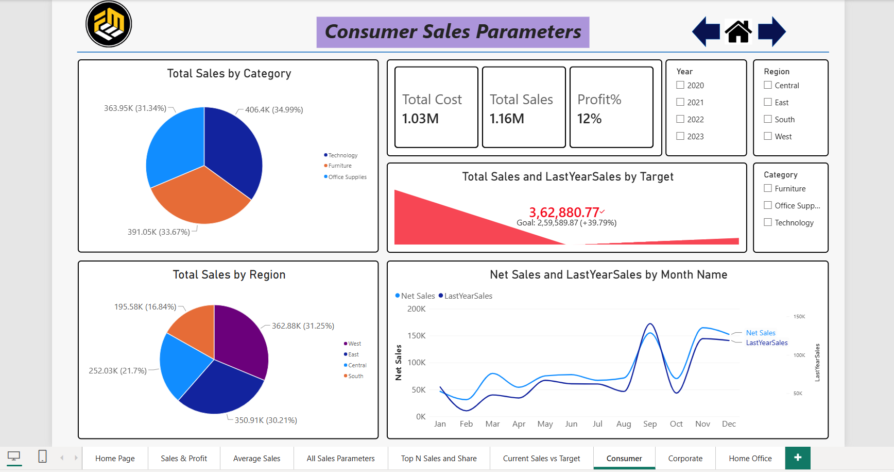
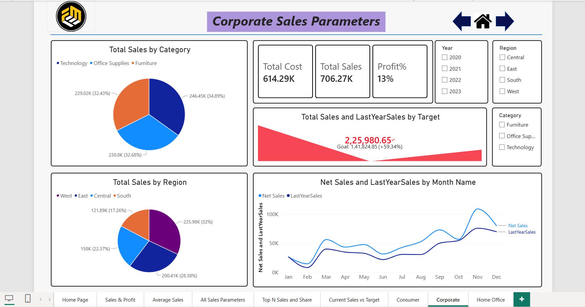
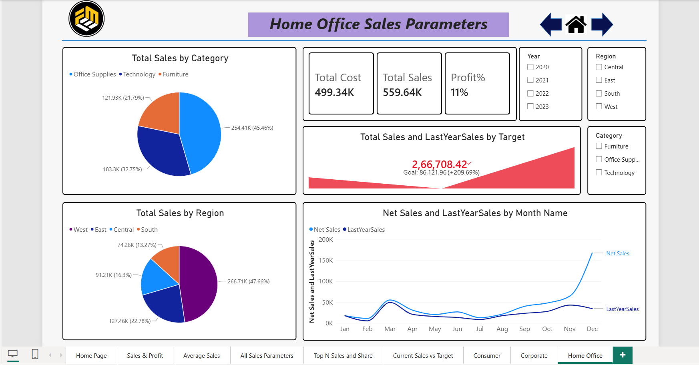

# 📊 Sales Analytics Dashboard | Power BI

## 📌 Project Overview

The **Sales Analytics Dashboard** is an interactive business intelligence project developed using Microsoft Power BI Desktop. The dashboard provides insights into sales performance, profitability, product performance, customer segments, regional sales, and sales target achievement.

The report helps users analyze business performance through interactive visualizations, KPI cards, charts, tables, and filters.

## 📸 Dashboard Preview

### 1. Sales Analytics Overview

### 2. Average Sales Analysis

### 3. All Sales Parameters

### 4. Top N Sales and Share

### 5. Current Sales vs Target

### 6. Consumer Sales Analysis

### 7. Corporate Sales Analysis

### 8. Home Office Sales Analysis

## 🎯 Project Objectives

- Analyze overall sales and profitability.
- Compare sales performance across product categories and regions.
- Understand sales trends using moving averages.
- Compare current sales with previous-year sales and sales targets.
- Identify top-performing products and customers.
- Analyze Consumer, Corporate, and Home Office sales performance.
- Monitor key performance indicators (KPIs) to support business decision-making.

## 🛠️ Tools and Technologies

- **Microsoft Power BI Desktop** – Dashboard development and visualization
- **DAX** – Measures and KPI calculations, where applicable
- **Data Visualization** – Charts, KPI cards, tables, and interactive filters
- **Business Intelligence** – Sales performance monitoring and analysis

## 📑 Dashboard Pages

### 1. Sales Analytics Overview

- Total Sales and Profit Percentage by Segment
- Total Profit by Segment
- Total Profit by Country and Region
- Sales and profitability comparisons across customer segments

### 2. Average Sales Analysis

- Total Sales by Day/Year
- Moving Average of Sales
- Total Profit by Shipping Mode
- Profit Percentage by Product Sub-Category

### 3. All Sales Parameters

- Total Sales by Category
- Total Sales by Region
- Total Cost, Total Sales, and Profit Percentage KPIs
- Current Sales versus Last-Year Sales
- Monthly Net Sales versus Last-Year Sales
- Interactive Year, Region, and Category filters

### 4. Top N Sales and Share Analysis

- Top N Product Sales Analysis
- Top 3 Product Sales Share
- Top 3 Customer Sales Share
- Total Sales by Top Products
- Interactive Top N selection
- Region, Category, and Year filters

### 5. Current Sales vs Target

- Net Sales versus Target Sales
- Monthly Net Sales and Target Sales
- Target Percentage parameter
- Sales target performance analysis

### 6. Consumer Sales Analysis

- Sales by Product Category
- Sales by Region
- Total Cost, Total Sales, and Profit Percentage
- Current Sales versus Last-Year Sales
- Monthly Sales Trend Analysis

### 7. Corporate Sales Analysis

- Category-wise and Region-wise Sales
- Total Cost, Total Sales, and Profit Percentage
- Sales versus Target Analysis
- Monthly Net Sales versus Last-Year Sales

### 8. Home Office Sales Analysis

- Sales by Product Category and Region
- Total Cost, Total Sales, and Profit Percentage
- Sales versus Target Analysis
- Monthly Sales Trend Analysis

## 📈 Key Performance Indicators (KPIs)

The dashboard covers the following KPIs and analytical metrics:

- Total Sales
- Total Cost
- Total Profit and Profit Percentage
- Moving Average of Sales
- Current-Year versus Last-Year Sales
- Net Sales versus Target Sales
- Top 3 Product Sales Share
- Top 3 Customer Sales Share
- Category-wise Sales
- Region-wise Sales
- Segment-wise Sales
- Shipping Mode Profit Analysis
- Monthly Sales Trends

## 🔍 Key Insights

Based on the values displayed in the supplied report:

- **Total Sales:** Approximately 2.43M.
- **Total Cost:** Approximately 2.14M.
- **Profit Percentage:** Approximately 12%.
- **Top Sales Category:** Technology, contributing approximately 849.16K in sales.
- **Regional Performance:** West is the leading region in the overall regional sales breakdown, with approximately 855.57K.
- **Top 3 Product Share:** Approximately 10.99%.
- **Top 3 Customer Share:** Approximately 10.45%.
- **Sales Target Analysis:** The report displays approximately 803.39K in Net Sales against 923.90K in Target Sales.
- **Customer Segment Analysis:** The report displays approximately 1.16M in Consumer sales, 706.27K in Corporate sales, and 559.64K in Home Office sales.

*Note: These values represent the report view shown in the PDF and may change depending on filters or selections.*

## 🎛️ Interactive Features

The dashboard includes interactive filters and parameters that allow users to explore sales performance by:

- Year
- Region
- Product Category
- Customer Segment
- Top N Products
- Target Percentage

These features help users investigate business performance from different perspectives.

## 💼 Business Value

This project demonstrates how Power BI can transform sales data into meaningful business insights. The dashboard helps users:

- Monitor important sales KPIs.
- Identify high-performing categories and regions.
- Compare actual sales against targets.
- Evaluate customer segment performance.
- Understand sales trends over time.
- Explore product and customer contributions to overall sales.

## 👨‍💻 Author

**Nagireddy Rakada Rupesh**

📬 Contact

Nagireddy Rakada Rupesh

📧 Email: nagireddyrakadarupesh@gmail.com

📱 Phone: +91 8374792489

💼 LinkedIn: www.linkedin.com/in/rakada-rupesh

🐙 GitHub: https://github.com/Rupesh-29

⭐ **If you find this project useful, feel free to explore the dashboard and its sales analytics approach.**
